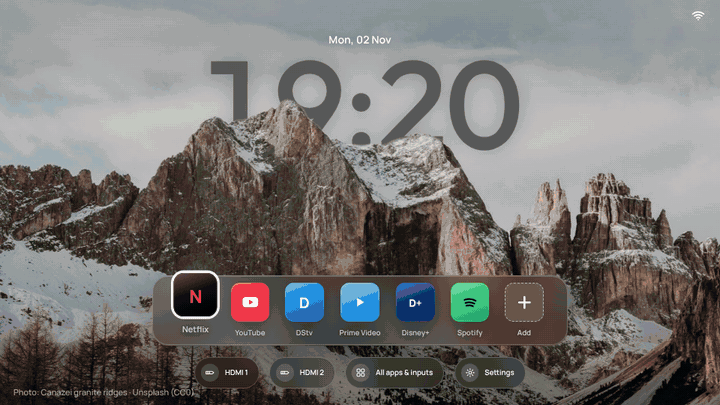
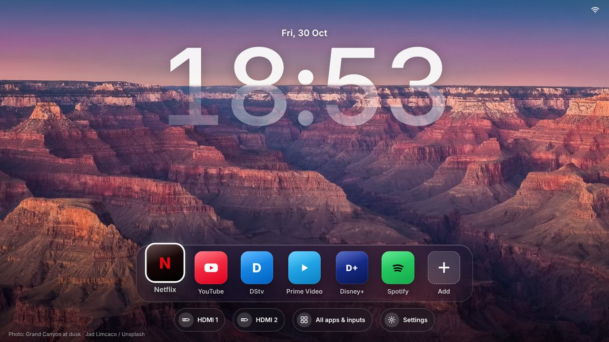
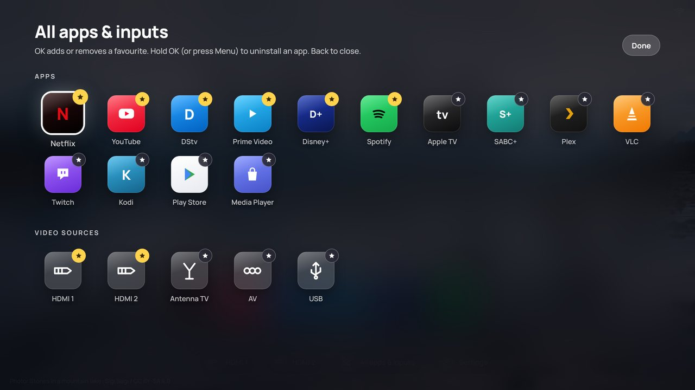
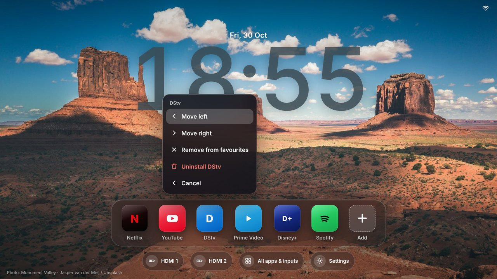
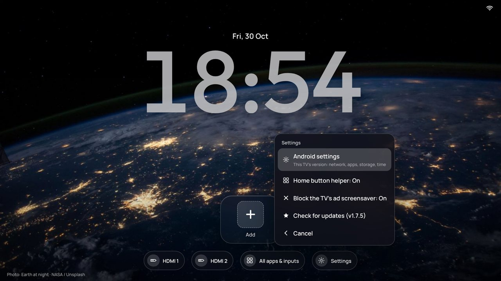
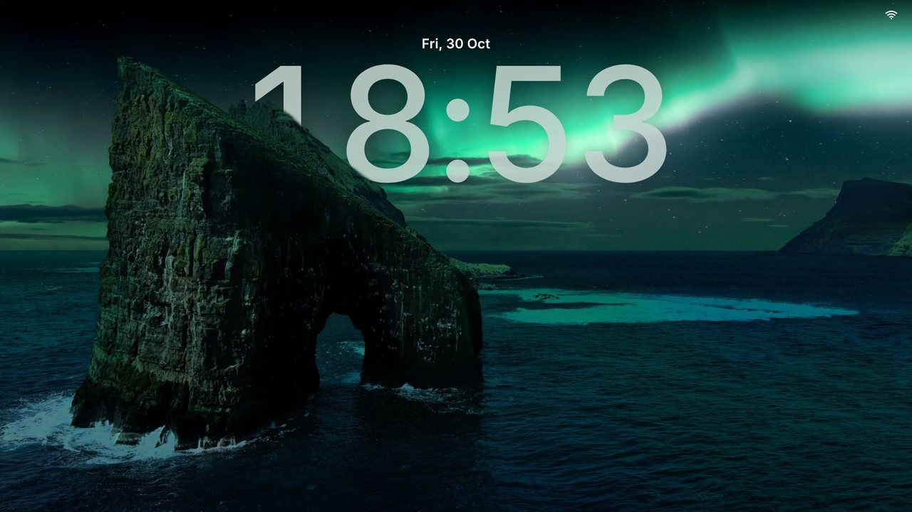

# Aurora Home

An iPhone-lockscreen-style home screen for Android TVs. Real photos rotate in the
background, the clock tucks behind mountains and buildings, and your favourite apps
sit in a glass dock along the bottom.

Built for a JVC LT-32N750A (Android 9, CVTE board) whose own home screen is full of
ads, and designed to survive the locks that cheap TVs put in the way. It works on most
Android TV sets running Android 5 or newer. Free and open source.



> Replaces your TV's ad-filled home screen with a quiet lock screen — and on budget TVs
> that hijack the Home button, it takes the button back and blocks the ad screensaver too.

*A free community side project — not a commercial product. Built and open-sourced by Jordan
of Mondcrest Automations (an AI agency for businesses); see [About this project](#about-this-project).*

## Contents

- [What it does](#what-it-does)
- [Screenshots](#screenshots)
- [Install](#install) · the full step-by-step is in [docs/INSTALL.md](docs/INSTALL.md)
- [Remote controls](#remote-controls)
- [Updating](#updating)
- [Known limits](#known-limits) · more in [docs/TROUBLESHOOTING.md](docs/TROUBLESHOOTING.md)
- [Does it work on my TV?](#does-it-work-on-my-tv)
- [Building it yourself](#building-it-yourself)
- [Privacy](#privacy)
- [About this project](#about-this-project)
- [Credits](#credits)

## What it does

- **Lockscreen look.** A random photo every time the TV turns on, then a new random
  photo every 5 minutes with a slow crossfade. On photos with a clear skyline the
  clock sits *behind* the scenery, like an iPhone lock screen.
- **Favourites dock.** Pick which apps sit in the dock. Hold OK on any app to move it,
  remove it from the dock, or uninstall it from the TV.
- **All apps & inputs.** Every installed app and every video input in one place. Press
  OK to add or remove a favourite.
- **Home button takeover.** On TVs that hard-wire the Home button to their own launcher,
  an optional accessibility helper sends Home to Aurora instead.
- **Ad screensaver blocker.** The same helper closes the TV's own ad screensaver and
  shows Aurora's calm clock screen instead. You can switch it off in Settings.
- **Calm screen.** After 3 minutes without a button press the dock fades away and only
  the photo and clock remain. Any button brings it back.
- **Self-update over Wi-Fi.** Settings → Check for updates pulls the newest version from
  this repo and installs it, with no USB stick after the first install.

## Screenshots

| Home screen | All apps & inputs |
| --- | --- |
|  |  |

| Edit an app (hold OK) | Settings |
| --- | --- |
|  |  |

| Calm screen (dock fades after 3 min) |
| --- |
|  |

## Install

**Short version** (full guide with photos: [docs/INSTALL.md](docs/INSTALL.md)):

1. Download [`AuroraHome.apk`](https://raw.githubusercontent.com/automations-mondcrest/aurora-tv/main/release/AuroraHome.apk)
   (also in the [`release/`](release) folder).
2. Copy it to the top level of a USB stick.
3. Plug the stick into the TV, open the TV's file browser (often called *Media Center*,
   *File Manager* or *USB*), select the APK and press OK. Allow the install if asked.
4. Press **Home**. If the TV asks which home screen to use, pick **Aurora Home** →
   **Always**.

### If Home still opens the TV's own launcher

Many budget TVs ignore the "default home app" setting. Aurora works around it with an
accessibility helper:

1. Open Aurora from the TV's app list, then hold **OK** on the **Settings** button.
2. Open the accessibility screen in the list (shown as **AccessibilitySettings**, or
   found under the TV's own settings).
3. Switch on **HomeKeyService** (also shown as *Aurora Home button*). Accept the warning.
4. Press **Home** — it now opens Aurora.

See [docs/TROUBLESHOOTING.md](docs/TROUBLESHOOTING.md) if the accessibility screen is
missing or locked.

## Remote controls

| Button | What it does |
| --- | --- |
| Arrows | Move around |
| OK | Open the focused app or button |
| Hold OK, or the Menu button | Edit the focused app (move, remove, uninstall) |
| Back | Close a panel |
| Channel Up | Jump to the next photo |
| Hold OK on **Settings** | Diagnostics: IP address, ad-blocks, hidden settings screens |

## Updating

Once Aurora 1.7.5 or newer is installed, you update from the TV:

1. Open **Settings → Check for updates**.
2. If a newer version exists, choose **Download and install**.
3. On TVs that allow app installs, the installer opens — press **Install**. On TVs that
   block installs from other apps (many CVTE sets), Aurora saves the update to the
   **Download** folder and opens the TV's file browser; go to Download, select
   `AuroraHome-update.apk` and press OK, then Install.

Your favourites and settings are kept across updates.

## Known limits

These are limits of the locked-down TVs, not the launcher. On an unlocked Android TV
(or an Android TV box) none of them apply.

- **Switching HDMI/AV directly** isn't possible on TVs that don't expose Android TV
  inputs (many CVTE/budget sets). The input buttons open the TV's own source menu
  instead; pick the input there, or use the remote's Source button.
- **Uninstalling built-in TV apps** needs root.
- **The blur/glass effects** depend on the TV's built-in web engine. Very old engines
  draw a flat panel instead — still fully usable.
- **Developer mode / network debugging** can't be turned on if the TV hides Android's
  settings screens. Without it, the update flow above is the ceiling for a no-root setup.

More detail and fixes: [docs/TROUBLESHOOTING.md](docs/TROUBLESHOOTING.md).

## Does it work on my TV?

| TV type | Home screen | Home button | Direct HDMI switch | Self-update |
| --- | --- | --- | --- | --- |
| Standard Android TV (Sony, TCL, Philips, Nvidia Shield…) | Yes | Yes, via the system "default home app" setting | Yes | Yes |
| Google TV | Yes | Usually, via the helper | Yes | Yes |
| CVTE / budget Android TV (many JVC, Hisense-clone, no-name sets) | Yes | Yes, via the helper | No — opens the source menu | Yes, via the file browser |
| Non-Android TVs (Samsung Tizen, LG webOS, Hisense VIDAA) | No — different OS, this app won't install | — | — | — |

## Building it yourself

The app is a single WebView activity plus a small Java bridge. It builds **without
Android Studio or Gradle**, using Ubuntu's Android packages:

```sh
sudo apt install aapt apksigner android-sdk-platform-23 dalvik-exchange zipalign default-jdk
./build.sh path/to/your.keystore your-alias
# -> app/build/AuroraHome.apk
```

- `web/aurora.tpl.html` — the UI, viewable in any browser as a preview.
- `tools/make_tv_page.py` — turns that preview into `app/assets/index.html` for the TV
  (bundles the fonts, writes the photos as files, rewrites modern CSS so old Android
  WebViews can render it, and wires in the native bridge). Run it after editing the UI.
- `app/src/com/mondcrest/aurora/` — the Java: `MainActivity` (WebView + bridge),
  `HomeKeyService` (Home button + ad blocker), `BootReceiver`, `ApkProvider`.

To publish an update: bump `versionName`/`versionCode` in `app/AndroidManifest.xml`,
build, copy the APK to both `release/AuroraHome.apk` and `release/AuroraHome-<version>.apk`,
and point `release/latest.json` at the versioned file. (GitHub's raw cache can serve an
old `AuroraHome.apk` for a few minutes; the versioned name avoids a stale download.)

**Signing.** An update only installs over an existing copy when both are signed with the
**same key**. Keep your keystore private and never commit it — anyone with it could push
an update to every TV running your build. `.gitignore` already excludes `*.keystore`.

## Privacy

Aurora has no analytics and no accounts. It talks to the network for two things only:
checking this GitHub repo for updates, and downloading an update you asked for. The
accessibility helper sees the Home button and the *names* of screens that open (to close
the ad screensaver); it never reads screen contents or anything you type.

## About this project

Aurora Home is a free community side project, released as open source for anyone to use. It
is **not a commercial product and not a service offering.**

It was built and published by Jordan of **[Mondcrest Automations](https://mondcrest.com)** —
an AI automation agency that builds custom automations, apps and SaaS for businesses.
Mondcrest's client work is separate from this hobby project; Aurora carries the name only to
credit who made it. For agency work, see [mondcrest.com](https://mondcrest.com); for Aurora,
this repo is the home.

Issues and pull requests are welcome here. Please don't route Aurora support through
Mondcrest's business channels.

## Credits

Photos and fonts are by others and keep their own licences — see [CREDITS.md](CREDITS.md).
Code is MIT-licensed — see [LICENSE](LICENSE).
